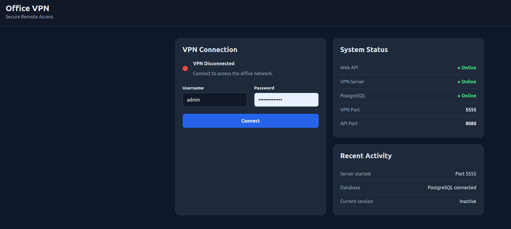

# Office VPN Simulator

## Description

Office VPN Simulator provides a browser dashboard and a JavaFX client for connecting to a multi-client encrypted TCP server. The main browser workflow checks service status and submits connect/disconnect requests to the Spring API, which manages a VPN client session; the JavaFX path connects directly. Server handlers authenticate users, enforce admin operations, exchange messages, and record connection activity in MySQL. The README documents roles, user administration, and connection logs. The sampled sources show these paths, though the web dashboard’s activity panel is not backed by a sampled activity API.

### Tech Stack

| Component | Tech |
| --- | --- |
| Local Run |  |
| Frontend |  |
| Backend |   |
| Scheduling |  |
| Database |   |
| Client Build |   |
| Server Build |  |
| CI |  |
| Repo Size |  |                                                               |

A learning-focused Java 21 application demonstrating:

- Java TCP sockets
- ECDH key agreement
- AES-256-GCM authenticated encryption
- PBKDF2 password hashing
- MySQL persistence
- JavaFX GUI
- Multi-client server handling
- User roles and access control
- Connection logging

## Project structure

    office-vpn/
    ├── pom.xml
    ├── README.md
    ├── database/schema.sql
    └── src/main/
        ├── java/com/lyle/vpn/
        │   ├── common/
        │   ├── server/
        │   └── client/
        └── resources/com/lyle/vpn/client/
            ├── login.fxml
            ├── dashboard.fxml
            └── styles.css

      
## System Architecture & Data Flow

## Screenshot

## Important security note

This is a **VPN simulator / secure application tunnel**, not a production operating-system VPN. It does not create a Windows/Linux virtual network adapter or route arbitrary IP packets.

Do not expose this project directly to the public Internet without further hardening, TLS/certificate authentication, firewall rules, rate limiting, key rotation, audit controls, and security testing.

## Requirements

- JDK 21+
- Maven 3.9+
- MySQL 8+
- Windows/Linux/macOS

## 1. Create the database

Run:

    mysql -u root -p < database/schema.sql

## 2. Configure the server

Set environment variables:

    DB_URL=jdbc:mysql://localhost:3306/office_vpn
    DB_USER=root
    DB_PASSWORD=your_mysql_password
    VPN_PORT=5555

On Windows PowerShell:

    $env:DB_URL="jdbc:mysql://localhost:3306/office_vpn"
    $env:DB_USER="root"
    $env:DB_PASSWORD="your_mysql_password"
    $env:VPN_PORT="5555"

## 3. Start the server

From the project directory:

    mvn -q exec:java -Dexec.mainClass=com.lyle.vpn.server.VpnServer

If your Maven installation does not have the exec plugin cached, use your IDE to run:

    com.lyle.vpn.server.VpnServer

On first startup, if no admin exists, the server prints a generated temporary admin password. Change it after logging in.

## 4. Start the JavaFX client

Run:

    mvn javafx:run

The GUI starts in client mode. Enter the server address, port, username and password.

## 5. Admin functions

An ADMIN account can:

- list users
- create users
- enable/disable users
- view recent connection logs

Normal users can connect and exchange encrypted messages with the server.

## Architecture

    JavaFX Client
          |
          | TCP
          v
    ECDH handshake
          |
          v
    AES-256-GCM encrypted frames
          |
          v
    Multi-client Java server
          |
       +--+--+
       |     |
     MySQL  Audit logs

## Cryptography

The server and client perform an ephemeral ECDH exchange using Java's standard security APIs. The resulting shared secret is expanded with SHA-256 to obtain an AES-256 key.

Application frames are encrypted with AES/GCM/NoPadding and a fresh 12-byte nonce for every encrypted frame.

Passwords use PBKDF2WithHmacSHA256 with a per-user random salt.

These choices are for learning. A production VPN should normally use a mature VPN protocol and implementation rather than inventing a protocol.

